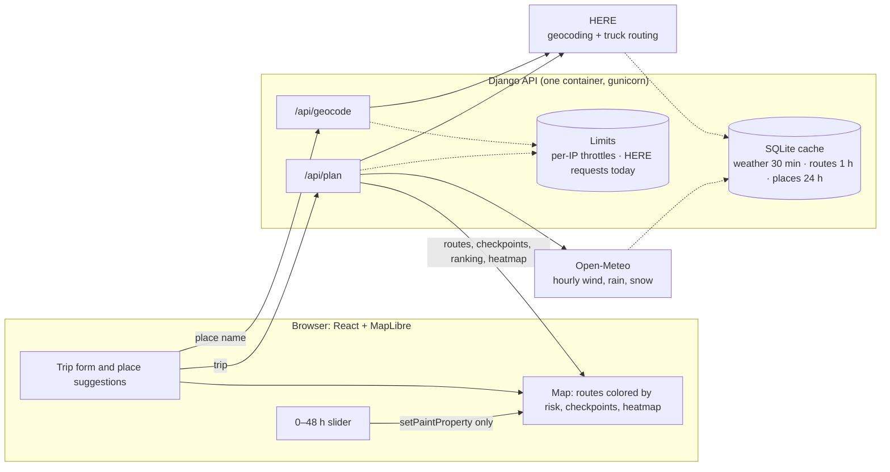

# Weather-Aware Truck Routing

A React + Django web app that helps a truck driver choose the safest route between two places, based on forecast weather along the way, the truck's load weight, and travel time.

> **Live:** https://weather-truck-routing.wittywave-86ad3def.eastasia.azurecontainerapps.io
>
> Plan a trip, compare up to three truck routes by the forecast risk along each one, and scrub a 0–48 h weather heatmap of the corridor. The first visit after a quiet spell takes a few seconds while the container starts.

## Architecture



Inside `/api/plan` (`backend/routing/planner.py`):

1. **Routes:** HERE truck routes on the gross weight (load plus an assumed 35,000 lb empty truck). If HERE returns fewer than 3, detours through points beside the fastest route make up the set (`alternatives.py`).
2. **Checkpoints:** every 10, 25 or 50 miles along each route (`sampling.py`). Each has an **ETA** from HERE's per-stretch travel times (`eta.py`).
3. **Weather:** each checkpoint, and each point of the corridor heatmap, is snapped to a shared 0.1° grid and de-duplicated. Only cells that aren't cached are fetched, in batches (`grid.py`, `weather.py`).
4. **Risk:** each checkpoint is classified with the forecast for the hour the truck gets there, and the load rules apply (`risk.py`). Each route gets a summary of its No Travel, Severe and High miles and its average risk (`recommend.py`).
5. **Recommendation:** routes are ranked by No Travel miles, then Severe, then High, then average risk, then travel time, with a one-line reason.
6. **Heatmap:** the corridor grid, with 49 hourly risk levels and the raw wind, rain and snow per point (`heatmap.py`). The browser draws it with no further requests.

## Backend setup

Requires Python 3.12+.

```powershell
cd backend
python -m venv .venv
.\.venv\Scripts\python.exe -m pip install -r requirements.txt
copy ..\.env.example .env      # then fill in the values
.\.venv\Scripts\python.exe manage.py runserver
```

On macOS/Linux, use `.venv/bin/python` in place of `.\.venv\Scripts\python.exe` and `cp` in place of `copy`.

Health check: `GET http://127.0.0.1:8000/api/health` returns `{"status": "ok"}`.

### Tests

```powershell
cd backend
.\.venv\Scripts\python.exe -m pytest
```

The tests run offline. Provider responses are recorded fixtures in `backend/routing/tests/fixtures/`.

## Frontend setup

Requires Node 20+. Run it alongside the backend:

```powershell
cd frontend
npm install
npm run dev        # http://localhost:5173 (API calls are proxied to Django on :8000)
```

`npm test`, `npm run typecheck`, `npm run lint` and `npm run e2e` (the end-to-end browser test) are described in [frontend/README.md](frontend/README.md).

## API

### `GET /api/geocode?q=Denver`

Up to 5 matches in the US, Canada and Mexico: `{"results": [{"label", "lat", "lon"}]}`.

### `POST /api/plan`

```json
{
  "origin": "Dallas, TX",
  "destination": {"lat": 39.74, "lon": -104.99, "label": "Denver, CO"},
  "departure": "2026-10-13T08:00:00-05:00",
  "weight_lb": 42000,
  "interval_mi": 25
}
```

- `origin` and `destination` take either a place name, which is geocoded to its best match, or coordinates from `/api/geocode`.
- `departure` is ISO 8601. A time with no offset is taken as UTC. It can be from 1 hour ago up to 13 days ahead, which keeps the trip and the 48 h heatmap inside Open-Meteo's forecast range. All times in the response are UTC with an explicit offset, and the web UI converts them to the user's local timezone for display.
- `weight_lb` is the **load**, from 0 to 80,000 lb.
- `interval_mi` is 10, 25 or 50.

The response has:
- `routes`: up to 3, each with distance, duration, a risk summary, a `[lon, lat]` line for the map, and its checkpoints. Each checkpoint has its mile, ETA, the forecast hour used, wind, rain and snow, the risk level, what caused it, and whether a load rule applied.
- `recommendation`: the chosen route, the full ranking, a one-line reason, and an optional warning.
- `heatmap`: the corridor grid for the 0–48 h slider. It contains:
  - `start`: the departure hour, which is slider position +0 h.
  - `cell_deg`: the grid spacing.
  - `points`: `[lon, lat]` pairs.
  - `risk`, `wind_mph`, `rain_in_hr` and `snow_in_hr`, each laid out as `[point][hour]` with 49 hours per point. `null` means no forecast for that hour.
- `notes`: for example, when a route was generated by the fallback.

Responses are gzip-compressed. A typical plan is about 180 KB as JSON and about 36 KB over the wire.

Errors:

| Status | Meaning |
|---|---|
| 400 | Invalid input, or a place name that can't be found |
| 422 | No truck route exists between the two places |
| 429 | Too many requests from this IP (see [Abuse protection](#abuse-protection)). "Too many requests from your connection. Try again in 42 seconds.", with `Retry-After`. |
| 502 | HERE or Open-Meteo failed. The message is safe to show and never includes the API key. |
| 503 | A free tier is used up for now. Open-Meteo still rate-limiting after one retry: "wait about a minute", `Retry-After: 60`. An Open-Meteo hourly or daily quota, or the [daily HERE cap](#abuse-protection): `Retry-After` until it resets. |

## Assumptions

### Risk thresholds and their boundaries

The assessment gives the bands as ranges that share their endpoints, for example rain "0.10–0.25" is Moderate and "0.25–0.50" is High. A value exactly on a shared endpoint goes into the **higher** band. This matches how the spec words its open ends: "<25 mph" is Low and "≥55 mph" is No Travel.

The one exception is where the spec's top band is a strict "greater than". Rain is No Travel only **above** 1.00 in/hr and snow only **above** 3.0 in/hr, so exactly 1.00 in/hr of rain and exactly 3.0 in/hr of snow are still Severe.

| Condition | Low | Moderate | High | Severe | No Travel |
|---|---|---|---|---|---|
| Wind (mph) | < 25 | 25 to < 35 | 35 to < 45 | 45 to < 55 | ≥ 55 |
| Rain (in/hr) | < 0.10 | 0.10 to < 0.25 | 0.25 to < 0.50 | 0.50 to 1.00 | > 1.00 |
| Snow (in/hr) | < 0.5 | 0.5 to < 1.0 | 1.0 to < 2.0 | 2.0 to 3.0 | > 3.0 |

Wind bands written as whole numbers in the spec ("25–34") are treated as continuous, so 34.9 mph is Moderate and 35 mph is High.

### Load rules

Load rules only change the **wind** level, and can only make it worse:

- ≥ 55 mph: No Travel for any load.
- 45 to < 55 mph with a load **over** 30,000 lb: No Travel. Exactly 30,000 lb stays Severe.
- 35 to < 45 mph with a load **over** 40,000 lb: Severe. Exactly 40,000 lb stays High.

A checkpoint's overall level is the worst of its wind, rain and snow levels. When two conditions tie, the one listed first in the spec (wind, then rain, then snow) is reported as the cause.

### Route recommendation and No Travel

Routes are compared one criterion at a time, moving to the next only on a tie:

1. **Fewest No Travel miles** (added; see below)
2. Fewest Severe miles
3. Fewest High miles
4. Lowest average risk
5. Shortest travel time

The spec's preference list starts at Severe and doesn't mention No Travel. No Travel is the worst level, so a route with any No Travel miles always ranks below one without, however many Severe miles the other has. Without this rule, a route crossing No Travel conditions could be recommended for having "0 Severe miles". If every route has No Travel miles, the safest is still ranked first, but the app shows a warning suggesting a later departure.

To keep tiny rounding differences from deciding the result, miles are compared to 0.1 mi and average risk to 0.01. Anything closer than that counts as a tie and falls through to the next criterion.

### Checkpoints and risk miles

- Checkpoints sit at the origin, at every 10, 25 or 50 miles (the user picks), and at the destination.
- Each checkpoint's weather stands for the road halfway back to the previous checkpoint and halfway on to the next. So "Severe miles" adds up the stretches around Severe checkpoints, and the stretches always sum to the route's length.
- Average risk is distance-weighted on a 0–4 scale: Low 0, Moderate 1, High 2, Severe 3, No Travel 4.

### Arrival times and forecast hour

- The ETA at each checkpoint comes from the travel time HERE reports for each stretch of road, not one average speed for the whole trip. HERE splits the route wherever the speed limit changes, and includes traffic expected at the departure time.
- Weather is read at the forecast hour nearest the ETA, with :30 rounding up. All times are handled in UTC.
- Checkpoint miles are measured along the route line itself, so they can differ from HERE's reported distance by a fraction of a percent.

### Weather data

- Weather comes from Open-Meteo's hourly forecast, in mph and inches to match the thresholds.
- Rain uses Open-Meteo's `rain`, which excludes snow. Snow uses `snowfall`, which is snow depth rather than water equivalent. Both are totals for the hour before the timestamp, so they read directly as in/hr.
- Every weather lookup is snapped to a shared 0.1° grid. See [Weather grid snapping](#weather-grid-snapping).
- If a forecast value is missing, that checkpoint counts as Low and the response adds a note saying so.
- Open-Meteo's free API is for non-commercial use. A production deployment would need their paid plan.

### Weather grid snapping

Every weather lookup, checkpoints and heatmap alike, is snapped to the centre of the nearest cell on one shared **0.1° grid**, and duplicates are removed before anything is fetched. Each checkpoint's response includes `weather_cell`, the `[lon, lat]` of the cell whose forecast it used.

**Why:** Open-Meteo bills per location (see the next section). With snapping:
- Checkpoints reuse heatmap cells.
- The three routes share cells where they overlap.
- Switching the checkpoint interval mostly hits cells that are already cached. Every 50-mile checkpoint is also a 25-mile one, in the same cell.

**Accuracy:** snapping moves each lookup by at most half a cell diagonally:

| Latitude | Cell size (lat × lon) | Furthest a lookup can move |
|---|---|---|
| 35°N | about 6.9 × 5.7 mi | about 4.5 mi (7 km) |
| 45°N | about 6.9 × 4.9 mi | about 4.2 mi |

On average a lookup moves about half that. Here's why that's an acceptable trade:

- **The forecast itself is on a grid.** Open-Meteo returns the value for the model grid cell that contains the point. In the US that's about 3 km for the first day or two (NOAA's HRRR model) and about 13 km after that (GFS). So a raw point query already reads a model cell, not the exact location. A 4-mile shift changes the result only near a cell edge, and at most to the next cell over.
- **A checkpoint already stands for a long stretch of road.** It covers half the gap to each neighbour: 5 to 25 miles either side, depending on the interval. A 4-mile shift is small next to that.
- **Timing is a bigger source of error.** The forecast hour is rounded to the nearest hour from the ETA. That's up to ±30 minutes, which is about ±30 miles at highway speed.
- **What can be missed:** features smaller than a few miles, such as one thunderstorm cell, can fall just outside a snapped point. Forecasts can't place those precisely at these lead times anyway.

### Weather call budget and caching

Open-Meteo bills by **location**, not by request. The free tier allows 600 locations a minute, 5,000 an hour and 10,000 a day. To stay well under the per-minute limit:

- **Budget per plan:** each plan is kept to about **450 locations**, checkpoints plus heatmap. The heatmap is sized against the checkpoints at the densest 10-mile interval, so it stays the same whichever interval is chosen (see [Heatmap](#heatmap)).
- **Caching:** each location's forecast is cached for 30 minutes. The cached window covers the departure day plus the next 2 days, so these all reuse it:
  - re-running a trip
  - changing the departure time within that day
  - switching the checkpoint interval
  - planning an overlapping trip
- **Rate limits:** if Open-Meteo returns 429 anyway, the batches that succeeded are kept. A per-minute limit gets **one short backoff and retry**: 5 s, or the server's `Retry-After` up to 10 s. If that also fails, the API returns 503 with "The free weather service is busy… Please wait about a minute and try again", and the UI shows that message. An **hourly or daily** limit isn't retried, because a few seconds can't help. The 503 says which limit was hit, and its `Retry-After` gives the seconds until it resets.
- **Where the cache lives:** in a SQLite file (`backend/cache.sqlite3`, Django's database cache in WAL mode). It survives a server restart and is shared by all worker processes. Entries expire after their TTL: weather 30 minutes, routes 1 hour, geocoding 24 hours. A plan's ~450 writes take about 50 ms. Django's file cache was measured at 5.7 s for the same writes, because it lists the whole cache directory on every write. Set `CACHE_BACKEND=locmem` for an in-memory cache, which the tests use. Set `CACHE_DB` to put the file elsewhere.
- **Render's free tier:** its disk is wiped whenever the service restarts, redeploys or spins down after 15 minutes without traffic, and free services can't attach a persistent disk. So the SQLite file helps while an instance is running, but it doesn't survive a Render sleep. Keeping the cache through sleeps would need a separate store, such as Render Key Value. See [Deployment](#deployment).

Measured on Dallas → Denver, back to back within one minute, with an empty cache:

| Action | Time | Locations in plan (shared) | New fetches | Total in the minute |
|---|---|---|---|---|
| First plan, 25 mi | 3.4 s | 342 (17) | 342 | 342 |
| Switch to 10 mi | 0.9 s | 439 (52) | 112 | 454 |
| Switch to 50 mi | 0.6 s | 302 (10) | 0 | 454 |
| Back to 25 mi | 0.6 s | 342 (17) | 0 | 454 |

Before snapping, the same sequence needed about 510 locations. Repeating it a minute later could hit the limit.

### Abuse protection

The hosted demo runs on free tiers, so one visitor (or a script) mustn't be able to use them up for everyone. All of this is in `backend/routing/limits.py`.

- **Per-IP throttles** (DRF throttling), each configurable by env var:

  | Endpoint | Limit | Env var |
  |---|---|---|
  | `POST /api/plan` | 10 a minute | `THROTTLE_PLAN_MINUTE` |
  | `POST /api/plan` | 100 a day | `THROTTLE_PLAN_DAY` |
  | `GET /api/geocode` | 60 a minute (place suggestions are debounced and cached, so typing uses far fewer) | `THROTTLE_GEOCODE_MINUTE` |

  Over the limit, the API answers 429 with `Retry-After` and "Too many requests from your connection. Try again in …", which the UI shows as is. `/api/health` isn't throttled.
- **The client IP:** behind Azure's ingress, the client is the last `X-Forwarded-For` entry (`NUM_PROXIES=1`, the default). Entries a client adds itself come before it, so they can't buy a fresh allowance. Deployed with no proxy in front, set `NUM_PROXIES=0` to use the socket address.
- **A global daily cap on HERE requests:** at most `HERE_DAILY_CAP` (default **300**) requests to HERE per UTC day, from all visitors together. HERE's free plan allows 30,000 a month each for routing and geocoding, about 1,000 a day. A new plan makes at most 7 (two geocodes, one route request, up to four detours), so 300 is still 40 or more brand-new plans a day.
  - Only real requests to HERE count. Cached routes and places are free, and keep working after the cap is reached.
  - The count is checked **before** sending, so a refused request never reaches HERE. Plan and place search then answer 503: "Daily demo limit reached. Try again tomorrow (the limit resets at 00:00 UTC).", with `Retry-After` set to the seconds until midnight UTC.
  - If the cap is reached in the middle of a plan, the whole plan stops with that message, rather than quietly showing fewer routes.
- **Usage log:** every HERE request logs the day's running total, e.g. `INFO routing.limits: HERE requests on 2026-10-13 (UTC): 37 of 300 (routing)`, so the day's last line is its total. Reaching the cap logs a warning. Logs go to stdout.
- **Where the counters live:** in their own `limits` cache (the `rate_limits` table, next to the provider cache), so a busy provider cache culling old entries can't reset them.

### Heatmap

- **Time range:** the slider runs from the **departure hour** (+0 h) to 48 hours later. That way, every frame overlaps the trip, even for a departure several days ahead. If the user leaves now, this is the same as a forecast that starts now.
- **Points:** heatmap points are cells of the shared 0.1° grid, every 1st, 2nd or 3rd cell and so on. They cover every cell within a corridor radius of any route, plus the cell under each route point. The map's heatmap blur shows color beyond that.
- **Size:** the backend picks the finest spacing, then the widest corridor (15 mi narrowing to 8 mi), that fits both limits:
  - at most 300 heatmap points, and
  - checkpoints plus heatmap within the 450-location budget, counting checkpoints at the 10-mile interval.

  Results:

  | Trip | Spacing | Corridor | Points |
  |---|---|---|---|
  | Short trips | 0.1° (about 7 mi) | 15 mi | |
  | Dallas → Denver | 0.2° (about 14 mi) | 10 mi | 268 |

- **Same grid for every interval:** the grid doesn't depend on which checkpoint interval is chosen, so switching intervals reuses the cached heatmap weather.
- **Risk:** each point and hour gets a risk level using the same thresholds and load rules as the checkpoints, so the heatmap and the route colors always agree.
- **Variables:** the map can show overall risk, or wind, rain or snow alone. Wind, rain and snow are colored by their own risk bands (wind before the load rules), so all four views use the same five colors. The legend lists each band's values.
- **Slider:** dragging the slider or switching the variable only changes the heatmap layer's `heatmap-weight` to another hour's property. Nothing is re-created or re-fetched. The track behind the slider shows the worst level anywhere in the corridor for each hour, and the selected route's arrival. The truck's position at the slider time is interpolated from the checkpoint ETAs.

#### How the heatmap is drawn

A heatmap adds up overlapping blurs, which on its own would misreport risk in two ways. The map corrects for both:

- **Calibrated blur.** The blur radius is 1.5 times the grid's row spacing at every zoom, and the intensity is set so that, inside the corridor, the summed value equals the point's own level. Each risk color sits on a flat stretch of the color ramp, so the remaining ±3% ripple can't change a color. Unit tests sum MapLibre's blur numerically to check this.
- **Hazards aren't averaged away.** This is the neighbour-max smoothing described next.

#### Heatmap smoothing: neighbour max

**The problem.** A heatmap colors each spot by the *sum* of the blurs around it. Inside a uniform area that sum equals the level (that's the calibration above). But a lone hazardous cell surrounded by clear ones is averaged with its neighbours. With the blur this map uses, it keeps only about half (48%) of its own weight, so a lone **Severe** cell draws between Moderate and High. A weather map for driving decisions must not understate a hazard.

**The rule.** Before drawing, each heatmap point takes the **worst level among itself and its 8 neighbours** on the grid, for every hour and every variable. A lone hazard becomes a 3 × 3 block of that level. Blurred, the block's center keeps 99% of the hazard's weight, so it shows in its true color at its own cell.

**The corridor's edge.** A cell on the edge has no neighbours outward, so its sum would still fall to about half. A ring of extra points just outside the corridor fixes that: each ring point carries the worst level of the corridor cells next to it. Ring points next to Low cells stay empty, so the clear corridor keeps its soft edge and only hazards extend past it.

**Example.** On a 0.2° grid (about 14 mi), a Severe cell surrounded by Low cells:

| | Drawn at the Severe cell | Drawn two cells away |
|---|---|---|
| Plain heatmap | between Moderate and High (0.49 on a 0–1 scale, where Moderate is 0.4, High 0.6, Severe 0.8) | Low |
| With neighbour max | **Severe** (0.79) | Low |

**The trade-off.** A hazard's drawn area grows by up to one grid cell (7–14 mi) in every direction. For a safety map, that's the cautious direction. A point with no forecast stays empty rather than borrowing a neighbour's level.

**What it doesn't change.** It applies only to the heatmap picture. Route colors, checkpoints, risk miles, the recommendation and the slider's hourly strip all use each cell's own forecast.

**Where it lives.** `heatSites` and `heatmapFeatures` in `frontend/src/lib/heatmap.ts`. The work runs once per plan, so the slider still only switches which precomputed hour the layer reads. `heatmap.test.ts` sums MapLibre's blur numerically and checks that a lone Severe cell reads as Severe in the middle of the corridor and on its edge, and that the clear field stays Low.

### Truck weight sent to the router

The user enters the **load**, but HERE's truck routing restrictions (bridge and road weight limits) use **gross** weight. The backend sends the load plus an assumed 35,000 lb for an empty tractor-trailer, so a 42,000 lb load routes as a 77,000 lb truck. The risk rules use the load as entered.

### Three routes

HERE is asked for 2 alternatives, but it returns *up to* that many. If fewer come back, the backend asks again, routing through a point 10% (then 20%) of the trip's straight-line distance to either side of the fastest route's midpoint. A detour is only kept if:
- it overlaps every route already kept by less than 90%, and
- it takes no more than 1.5× the fastest route's time.

If no detour qualifies, fewer routes are shown and the response explains why. Generated routes are marked `"source": "via-point"`. For example, HERE gives 2 routes for Dallas to Oklahoma City and 3 for Dallas to Denver.

## Deployment

**Live:** https://weather-truck-routing.wittywave-86ad3def.eastasia.azurecontainerapps.io

The whole app is **one Docker container**. The [Dockerfile](Dockerfile) builds the React app with Node, then runs Django under gunicorn. WhiteNoise serves the built files, and Django serves the API at `/api/` and the app's `index.html` at every other path. There's one URL and no CORS.

- **Caching:** hashed files under `/assets/` are cached for good (`immutable`) and served pre-compressed. The app's own code is a separate 10 KB (gzipped) file, so an update doesn't make browsers download MapLibre (286 KB gzipped) or React again. `index.html` is `no-cache`, so a redeploy shows up on the next visit.
- **In production** (`DJANGO_DEBUG=0`), the API renders JSON only, and Django serves no static files of its own.
- **Startup:** the container creates the SQLite cache once (`manage.py createcachetable`) before gunicorn starts its 2 workers × 4 threads. Several workers creating a fresh SQLite file at the same moment can fail with "database is locked".

### Environment variables

| Variable | Needed | Notes |
|---|---|---|
| `HERE_API_KEY` | yes | Store it as a secret. It stays server-side and is never sent to the browser. |
| `DJANGO_SECRET_KEY` | yes | A long random string, also stored as a secret |
| `DJANGO_DEBUG` | yes | `0` |
| `DJANGO_ALLOWED_HOSTS` | on Azure | The app's own hostname, e.g. `weather-truck-routing.<environment>.<region>.azurecontainerapps.io`. On Render it's added automatically, from `RENDER_EXTERNAL_HOSTNAME`. |
| `CACHE_BACKEND`, `CACHE_DB` | | See [Weather call budget and caching](#weather-call-budget-and-caching) |
| `HERE_DAILY_CAP` | | HERE requests allowed per UTC day, from all visitors together. Default `300`. |
| `THROTTLE_PLAN_MINUTE`, `THROTTLE_PLAN_DAY`, `THROTTLE_GEOCODE_MINUTE` | | Per-IP rates, e.g. `10/minute`. Defaults `10/minute`, `100/day`, `60/minute`. |
| `NUM_PROXIES` | | Proxies in front of the app, for finding the client IP. Default `1` (Azure's ingress); `0` with none. |
| `LOG_LEVEL` | | The app's own log level. Default `INFO`, which logs each HERE request with the day's total. |

See [Abuse protection](#abuse-protection).

Don't set `FROZEN_NOW` or `HTTP_FIXTURES`; they're for the end-to-end tests. With `FROZEN_NOW` set, the app refuses to start unless debug is on.

### Azure Container Apps (how the live app runs)

- **Image:** [.github/workflows/image.yml](.github/workflows/image.yml) builds it on every push to `main` and publishes it to GitHub's container registry, `ghcr.io/ammad172/weather-truck-routing:<commit>`. The package is public, so Azure pulls it without credentials.
- **The app:** 0.5 vCPU / 1 GiB, scale to zero (at most 1 replica), external HTTPS ingress on port 10000. It's tagged `project=weather-truck-routing`.
- **Environment:** a Consumption-only Container Apps environment with no log workspace, so there's no extra cost. Idle time costs nothing, and use stays inside the Container Apps monthly free grant.

To create it (Azure CLI, signed in with `az login`):

```powershell
az containerapp env create --name wtr-env2 --resource-group <group> --location eastasia `
  --enable-workload-profiles false --logs-destination none --tags project=weather-truck-routing

az containerapp create --name weather-truck-routing --resource-group <group> --environment wtr-env2 `
  --image ghcr.io/ammad172/weather-truck-routing:<commit> --ingress external --target-port 10000 `
  --min-replicas 0 --max-replicas 1 --cpu 0.5 --memory 1.0Gi `
  --secrets here-api-key=<HERE key> django-secret-key=<random> `
  --env-vars HERE_API_KEY=secretref:here-api-key DJANGO_SECRET_KEY=secretref:django-secret-key `
             DJANGO_DEBUG=0 DJANGO_ALLOWED_HOSTS=weather-truck-routing.<environment domain>
```

To deploy a new version: push to `main`, wait for the image workflow to finish, then point the app at the new image with `az containerapp update --image ghcr.io/ammad172/weather-truck-routing:<commit>`.

What we learned deploying:

- **Set `DJANGO_ALLOWED_HOSTS` when you create the app.** Our first environment came up as an Azure *express* environment. It has a single `--latest` revision and doesn't allow revision suffixes, and an environment-variable update was never rolled out to the running revision, which kept answering every request with 400. Creating the app with its hostname already set, in a `--enable-workload-profiles false` environment, worked first time. The settings also try to work out the hostname from Azure's `CONTAINER_APP_NAME` and `CONTAINER_APP_ENV_DNS_SUFFIX` variables, but on Azure don't rely on that: set it explicitly.
- **There's no log workspace.** `az containerapp logs show` doesn't work without one. To read logs, including the daily HERE usage lines, add a Log Analytics workspace (its first 5 GB a month are free).

> **Cold start:** with scale to zero, the first visit after a quiet spell starts the container, which takes a few seconds. After that the app answers immediately. The weather cache starts empty in each new container, so the first plan after a cold start fetches all of its weather.

### Render

[render.yaml](render.yaml) is a Render Blueprint for one free Docker web service, with a generated `DJANGO_SECRET_KEY` and `HERE_API_KEY` entered when the Blueprint is created. **Render asks for a card to create any Blueprint**, even a free one. Without a card, create the service by hand instead: **New → Web Service**, then pick Docker and the Free instance type, set the health check path to `/api/health`, and enter the variables above. Render's free tier sleeps after 15 minutes without traffic, takes about a minute to wake, and wipes its disk (and so the cache) on every sleep.

## Edge cases

What the app does in unusual situations, and where each case is tested. Backend tests are in `backend/routing/tests/`, and end-to-end tests in `frontend/e2e/`.

| Situation | What happens | Tested in |
|---|---|---|
| From and To less than 1 mile apart | 400: "From and To are less than 1 mile apart. Choose two different places." Checked before any HERE or Open-Meteo call. (Before Phase 6 this crashed with a 500.) | `test_views.py`, `errors.spec.ts` |
| A place that can't be found | 400: `Couldn't find "<text>".`, shown on the right field | `test_views.py` |
| No truck route (e.g. to an island) | 422: "No truck route was found between these places." | `test_views.py`, `test_planner.py`, `errors.spec.ts` |
| HERE returns fewer than 3 routes | Detours fill in; if none qualifies, fewer routes are shown with a note saying why | `test_alternatives.py` |
| Departure more than 1 hour ago, or more than 13 days ahead | 400 on the Departure field. The form limits the range too. | `test_views.py`, `errors.spec.ts` |
| Load below 0 or above 80,000 lb | 400 on the Load field. The form limits it too. | `test_views.py` |
| No forecast for a checkpoint's hour | Counted as Low, and the plan includes a note. The checkpoint popup says "No forecast for this hour". | `test_planner.py` |
| Every route crosses No Travel | The best one is still recommended, with the warning "Every route crosses No Travel conditions. Consider a later departure." | `test_recommend.py` |
| Routes tie on every criterion | Kept in HERE's order; differences under 0.1 mi or 0.01 average risk count as ties | `test_recommend.py` |
| Wind at 47 mph with a 35,000 lb load | No Travel (the load rule), and that route ranks last | `test_planner.py`, `test_heatmap.py` |
| Open-Meteo per-minute limit | One short retry, then 503 "busy… wait about a minute" | `test_weather.py`, `test_views.py` |
| Open-Meteo hourly or daily limit used up | No retry (it can't help). 503 naming the limit, with `Retry-After` until it resets. | `test_weather.py`, `test_views.py`, `errors.spec.ts` |
| One IP sends more than 10 plans a minute, 100 a day, or 60 place searches a minute | 429 "Too many requests from your connection. Try again in …", with `Retry-After`. Nothing reaches HERE or Open-Meteo. | `test_limits.py` |
| The daily HERE cap is reached | 503 "Daily demo limit reached. Try again tomorrow…", with `Retry-After` until midnight UTC. HERE isn't called; cached routes and places still work. | `test_limits.py` |
| HERE or Open-Meteo fails | 502 with a readable message that never includes the API key | `test_views.py`, `test_here.py` |
| Connection drops, or the server can't be reached | "Couldn't reach the server. Check your connection and try again." | `errors.spec.ts` |
| A proxy error page instead of JSON | "The server had a problem. Please try again." | `errors.spec.ts` |
| A re-plan (e.g. a new interval) fails | The previous routes stay on screen, and the error says so | `errors.spec.ts` |
| A trip longer than the 48 h heatmap | The slider's "Arrives" mark is hidden. At +48 h the truck shows its mile, not "arrived". | not directly tested (follows from `truck.ts` and `ForecastTimeline.tsx`) |
| A lone storm cell in the heatmap | Drawn in its true color, not averaged away (see [Heatmap smoothing](#heatmap-smoothing-neighbour-max)) | `heatmap.test.ts` |
| Dragging the slider very fast | Only the heatmap's weight changes: no new layers, no new data, no network requests | `heatmap.spec.ts` |
| A phone screen | The timeline moves below the map, and both ends of the trip stay in view | `mobile.spec.ts` |
| Daylight-saving time and non-US time zones | All times use the browser's time zone; tests run in America/Chicago | `time.test.ts`, `plan.spec.ts` |
| Two server workers starting on a fresh cache | The cache is created once before the workers start; a 6-process test covers it | `test_cache.py` |

## Limitations

- **Heatmap resolution depends on trip length.** Open-Meteo's free tier limits how many locations a plan can afford, so longer corridors get coarser heatmaps:

  | Trip | Spacing | Corridor | Points |
  |---|---|---|---|
  | Short trip | about 7 mi | 15 mi | |
  | Dallas → Denver, 800 mi with three diverging routes | about 14 mi | 10 mi | 268 |

  Weather features smaller than a cell, such as a single thunderstorm cell or a narrow snow band, get averaged into the surrounding area. Checkpoint risk, which drives the recommendation, is affected much less: each checkpoint uses the 0.1° cell nearest to it. See [Weather grid snapping](#weather-grid-snapping).
- **Very long trips at a 10-mile interval.** Three coast-to-coast routes at 10 miles have more checkpoint cells than the free tier allows per minute. For those trips the heatmap drops to its minimum (100 points), and the plan may still return the "busy, try again in a minute" message. A 25- or 50-mile interval works.
- **The daily HERE count resets when the container does.** The counters are in the container's SQLite file, and the live app scales to zero when idle, so a fresh container starts its day's count from 0. Sustained use keeps the container running, so the cap holds while someone is actually using it. A cap that survives restarts would need a store outside the container, such as Redis or an Azure Files volume.
- **Back-to-back new trips.** Two or three completely new trips planned within one minute can still exceed the free tier's per-minute limit. The one automatic retry covers short bursts. Beyond that, the user sees the "wait about a minute" message rather than a broken page.

## Walkthrough script (about 5 minutes)

A script for a screen recording of the live app. The checks below each step are what the viewer should see.

**Before recording**
- Open the live URL once, plan the demo trip (Dallas, TX → Denver, CO, 42,000 lb, 25 mi), then switch to 10 mi once. That starts the container and fills the weather cache for 30 minutes, so the recorded plans come back quickly.
- Use a desktop browser window about 1440 × 900.
- Each fresh trip costs about 350 of Open-Meteo's free 600 locations a minute. Re-planning the same trip or switching to 50 mi costs none, because the weather is cached. Changing the load costs little or nothing: the weather is cached, but HERE may route a heavier truck slightly differently. Switching to 10 mi adds about 110 more locations the first time.

**1. The problem (0:00–0:30)**
- Show the empty map. Say: "A truck driver choosing between routes needs to know what the weather will be *where the truck is, when it gets there*, not what it's like now. And how dangerous wind is depends on how heavy the load is."

**2. Plan a trip (0:30–1:15)**
- Type "Dallas" in From and pick *Dallas, TX*; type "Denver" in To and pick *Denver, CO*. Departure stays at the next hour; load 42,000 lb; checkpoints every 25 mi. Click **Plan routes**.
- Point at the three routes: the recommended one is drawn on top, colored by risk; the others are grey. Read out the recommendation and its one-line reason.
- Check: all times are in your own time zone, as the footer says.

**3. Why this route (1:15–2:15)**
- Go through the route cards: travel time, distance, arrival, the risk bar along the route, and miles at No Travel, Severe and High.
- Explain the ranking: fewest No Travel miles first, then Severe, then High, then average risk, and only then travel time. Safety comes before speed.
- Click another route card: the map and the checkpoint table switch to it.
- Click a checkpoint row: the map flies there, and the popup shows the arrival time, the forecast for that hour, and what caused the risk level.

**4. Load matters (2:15–2:45)**
- Change the load to 25,000 lb and click **Re-plan routes**. If a route had strong wind, its risk may drop, because the heavier-load rules no longer apply (for example, 45–55 mph wind is No Travel above 30,000 lb). This needs few or no new weather calls.
- Set it back to 42,000 lb.

**5. The forecast heatmap (2:45–4:00)**
- Drag the slider slowly from Departure to +48 h. The corridor heatmap changes hour by hour, the truck moves along the selected route, and the label reads "+N h after departure" with the local time.
- Point at the strip behind the slider: each cell is the worst forecast anywhere in the corridor that hour. The dotted mark is when the truck arrives.
- Drag fast back and forth: it stays smooth, and nothing is fetched.
- Switch to **Wind**, **Rain** and **Snow**. The legend shows each one's bands (e.g. wind in mph), in the same five colors.
- Press **Play** to animate it, then pause.

**6. Checkpoint spacing (4:00–4:20)**
- Switch to **10 mi**, then **50 mi**: the plan updates straight away with more or fewer checkpoints. Both come from the weather cache, which was warmed before recording.

**7. How it's built (4:20–5:00)**
- One Django + React container. HERE provides geocoding and truck routing (on the truck's gross weight), and Open-Meteo the hourly forecasts.
- Weather lookups snap to a shared 0.1° grid and are cached, which keeps a plan within the free tier.
- The heatmap shows the worst of each cell's neighbours, so a single storm cell is never averaged away.
- Tests: 229 backend tests, 40 frontend unit tests, and 10 end-to-end tests that replay recorded API responses.

## License

© 2026 Ammad Khan. All rights reserved. This code is shared for evaluation and portfolio purposes only. No licence is granted to copy, modify, or use it. See [LICENSE](LICENSE).
